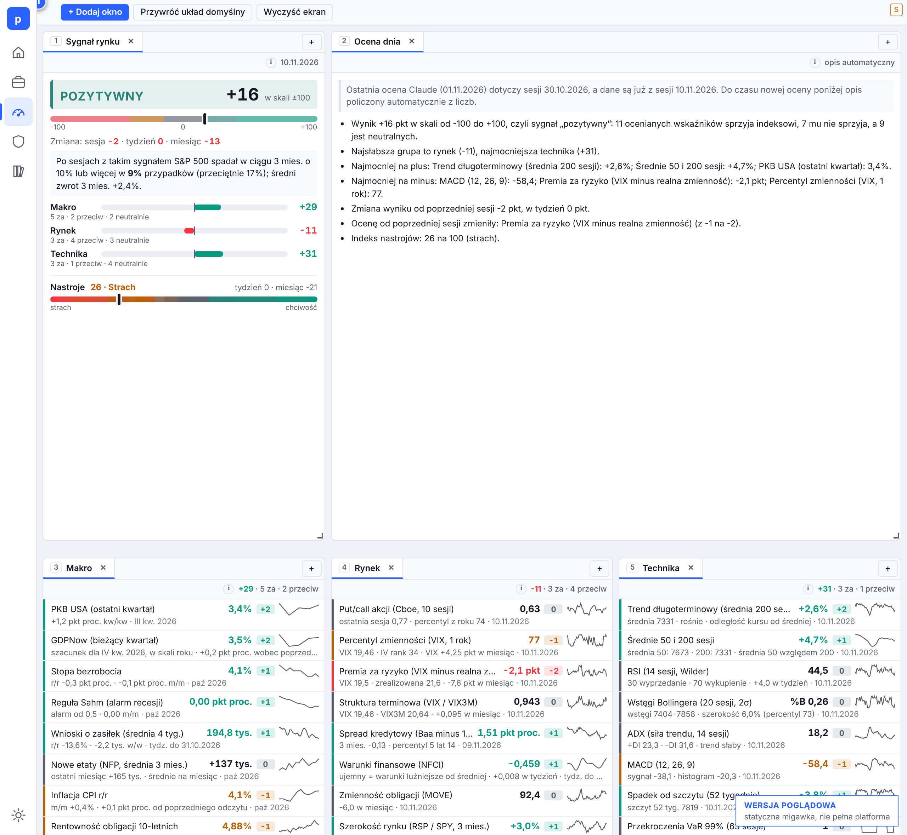
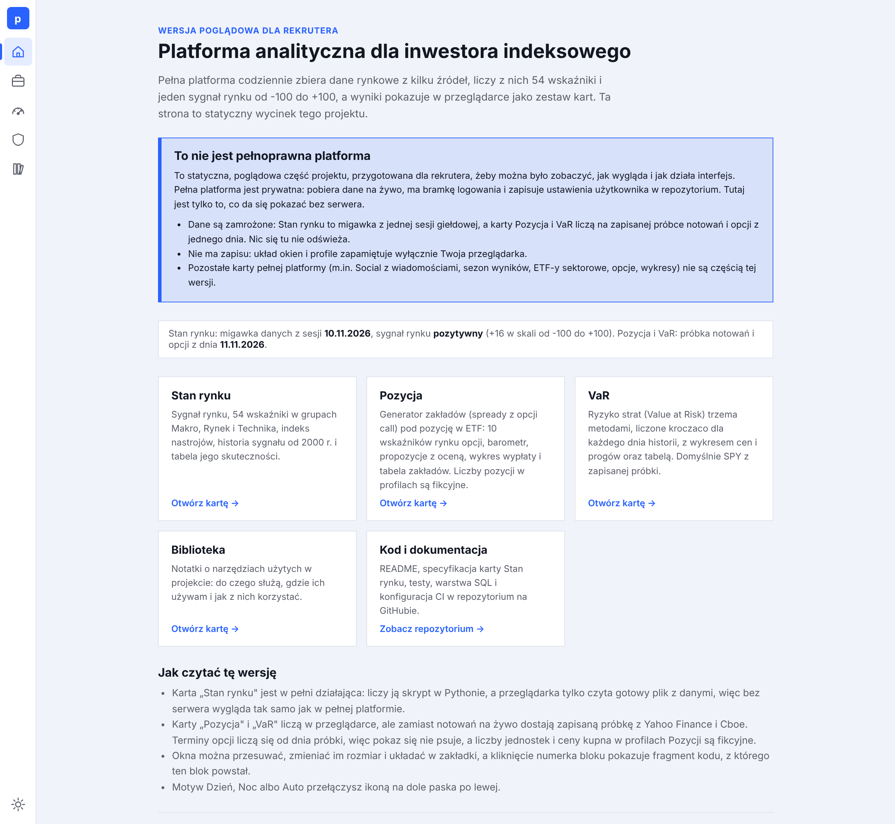
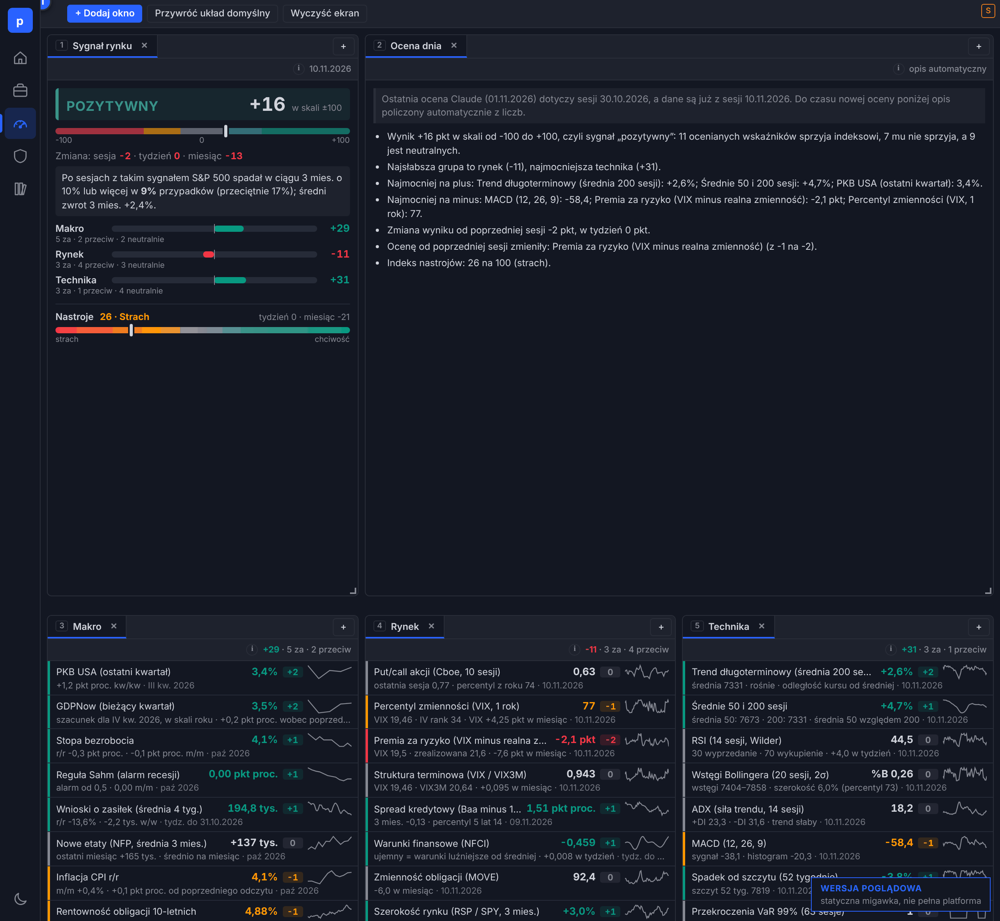
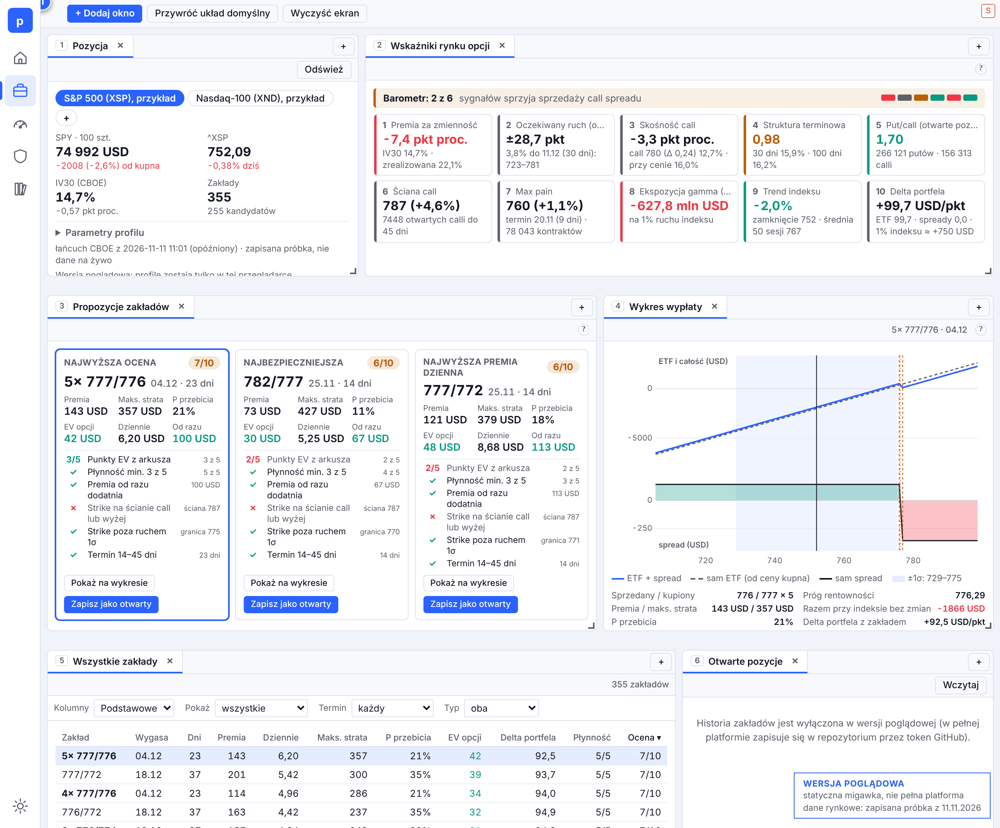
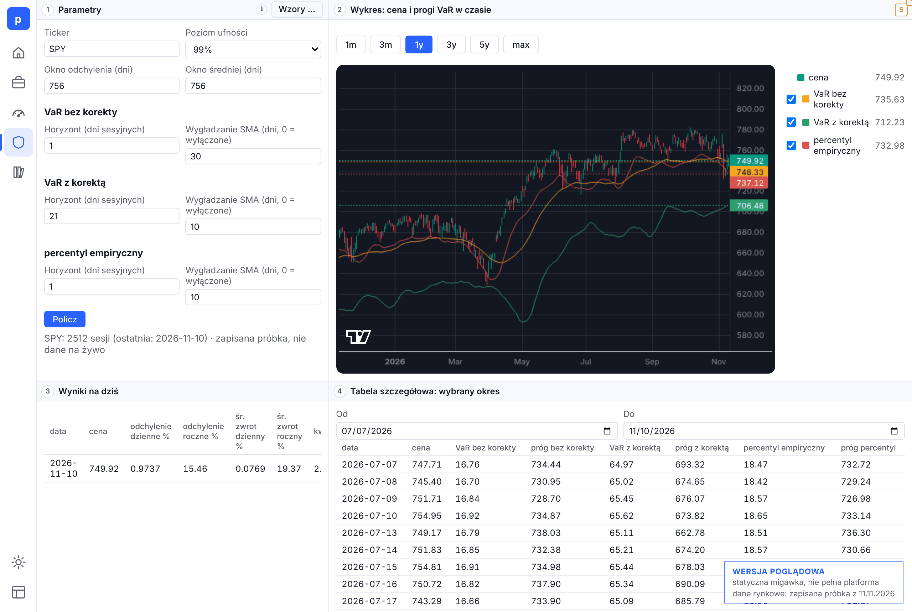
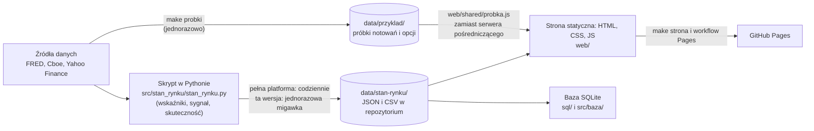

# Platforma inwestycyjna: wersja poglądowa dla rekrutera

[](https://github.com/kobimpw/platforma_inwestycyjna/actions/workflows/ci.yml)


-orange)

> [!IMPORTANT]
> **To jest statyczna, poglądowa część projektu, przeznaczona dla rekrutera, a nie pełnoprawna platforma.**
> Pełna platforma jest prywatna: zbiera dane na żywo, ma bramkę logowania i zapisuje ustawienia użytkownika w
> repozytorium. Tutaj jest tylko to, co da się pokazać bez serwera: karta „Stan rynku" z danymi **zamrożonymi na
> sesji z 10.11.2026**, karty „Pozycja" i „VaR" liczące na **zapisanej próbce notowań i opcji z 11.11.2026**, karta
> „Biblioteka", warstwa SQL, testy i CI.
>
> **[Zobacz stronę na żywo](https://kobimpw.github.io/platforma_inwestycyjna/)** (GitHub Pages, bez logowania i bez instalacji).



<details>
<summary>English summary</summary>

A **static, illustrative edition** of an analytics platform for an index investor (S&P 500), prepared for recruiters. It
is **not the full platform**, which is private: it collects market data live, sits behind a login gate and saves user
settings in its repository. This edition contains only what can be shown without a server: the "Stan rynku" (market
state) card with data frozen at the 10 Nov 2026 session, the "Pozycja" (position: a generator of call-spread bets with
expected-value scoring) and "VaR" (value at risk) cards running in the browser on a saved sample of Yahoo Finance prices
and Cboe option chains from 11 Nov 2026, a small "Biblioteka" (library notes) card, the SQL layer, tests and CI. A Python
script computes 54 indicators and a single market signal from -100 to +100, whose historical behaviour is evaluated in a
table; a static front end (plain HTML, CSS and JavaScript, no build step) renders the result, and a GitHub Actions
workflow publishes it to GitHub Pages. The social and news cards of the full platform are described below but not
included, because they rely on third-party content. The repository documents its own method: the specification of the
card is included, and its limitations (in-sample calibration, overlapping windows) are stated openly. The text of the
project is in Polish.

</details>

## Co to jest i po co

Inwestor indeksowy kupuje cały indeks, więc nie interesują go ciekawostki o pojedynczych spółkach, tylko to, co rusza
całym rynkiem: stopy i makroekonomia, nastroje i opcje, szerokość rynku. Pełna platforma zbiera te informacje w jednym
miejscu i zamienia je na liczby, które da się porównywać dzień po dniu. To narzędzie osobiste: opisuje warunki i ryzyko
na rynku, a nie jest rekomendacją inwestycyjną.

## Co jest w tej wersji, a czego nie ma

| Jest w tym repozytorium | Czego tu nie ma (jest tylko w pełnej, prywatnej platformie) |
|---|---|
| karta „Stan rynku": sygnał rynku, 54 wskaźniki, nastroje, historia sygnału i tabela jego skuteczności | pozostałe karty (lista niżej): Social, Earnings, ETF sektorowe, News, Youtube, opcje, wykresy, analiza techniczna, Studio |
| karta „Pozycja": generator zakładów z opcji call pod pozycję w ETF, 10 wskaźników rynku opcji, propozycje z oceną, wykres wypłaty | prawdziwe pozycje autora i historia zakładów zapisywana w repozytorium (tu profile są fikcyjne) |
| karta „VaR": ryzyko strat trzema metodami, liczone dla każdego dnia historii, z wykresem cen i progów | pobieranie notowań i opcji na żywo, bramka logowania i serwery pośredniczące do źródeł danych |
| karta „Biblioteka": notatki o narzędziach użytych w kodzie | |
| zapisana próbka notowań (Yahoo Finance) i łańcuchów opcji (Cboe) z jednego dnia dla Pozycji i VaR | codzienne odświeżanie danych |
| skrypt, który liczy wskaźniki i sygnał (`src/stan_rynku/stan_rynku.py`) | codzienne potoki danych (GitHub Actions) i zaplanowane zadania asystenta Claude |
| warstwa SQL: schemat, widoki, testy porównujące widoki z niezależnym rachunkiem | osobiste ustawienia i zapisywanie ich ze strony do repozytorium |
| testy, CI, budowa statycznej strony i jej publikacja na GitHub Pages | treści osób trzecich (transkrypcje, artykuły) i nagrania |

Pełna platforma zapisuje ustawienia osobiste w repozytorium, korzysta z prywatnych usług i materiałów osób trzecich, więc
nie może być publiczna w całości. Ta wersja jest oczyszczoną kopią z jawną listą dozwolonych plików, której pilnuje test
(`tests/test_wersja_pogladowa.py`).

## Jak obejrzeć

**Online:** [kobimpw.github.io/platforma_inwestycyjna](https://kobimpw.github.io/platforma_inwestycyjna/). Strona startowa
wyjaśnia, czym jest ta wersja, a na każdej podstronie w rogu widać pasek „Wersja poglądowa" (na kartach Pozycja i VaR
także datę zapisanej próbki). Okna na kartach „Stan rynku" i „Pozycja" można przesuwać, zmieniać im rozmiar i układać w
zakładki, a kliknięcie numerka bloku pokazuje fragment kodu, z którego ten blok powstał. Na karcie „VaR" można wpisać inny
ticker z zapisanych próbek (SPY, QQQ, ^GSPC, ^NDX, ^XSP) i kliknąć „Policz". Motyw Dzień, Noc albo Auto przełącza ikona na
dole paska po lewej.

**Lokalnie:**

```bash
git clone https://github.com/kobimpw/platforma_inwestycyjna.git && cd platforma_inwestycyjna
python3.11 -m venv .venv && source .venv/bin/activate
make install     # zależności do pracy nad kodem (testy i linter)
make check       # ruff, kontrola składni JS i wszystkie testy
make serve       # podgląd strony: http://127.0.0.1:8000/
make db          # baza SQLite zbudowana z plików w data/
python src/baza/baza.py zapytanie v_skutecznosc_sygnalu    # przykładowe zapytanie
make probki      # (opcjonalnie, wymaga internetu) pobiera od nowa próbki notowań i opcji dla Pozycji i VaR
```

`make help` pokazuje wszystkie polecenia. Aby zobaczyć stronę tak, jak ją składa publikacja, uruchom `make strona` (wynik w
katalogu `_site/`).

<details>
<summary>Strona startowa i motyw Noc</summary>





</details>

## Co pokazuje

**Sygnał rynku.** Karta „Stan rynku" ocenia 27 wskaźników (z 54 pokazywanych) według progów i wag i składa z nich jeden
wynik od -100 do +100 w pięciu poziomach. Poniższa tabela pokazuje, jak zachowywał się S&P 500 po sesjach z każdym
poziomem (26.12.2000 do 10.11.2026, 6507 sesji):

| Poziom sygnału | Udział sesji | Średni zwrot po 3 miesiącach | Spadek o 10% lub więcej w ciągu 3 miesięcy |
|---|---|---|---|
| silnie pozytywny | 10,0% | +0,75% | 4,1% |
| pozytywny | 50,6% | +2,39% | 8,5% |
| neutralny | 17,8% | +3,91% | 19,1% |
| negatywny | 13,8% | +0,65% | 35,5% |
| silnie negatywny | 7,7% | +0,07% | 44,3% |
| wszystkie sesje | 100% | +2,07% | 16,5% |

Jak to czytać: sygnał dużo lepiej opisuje **ryzyko spadku** niż przyszły zwrot. Po sesjach z poziomem negatywnym lub
silnie negatywnym spadek o 10% w trzy miesiące zdarzał się w 36–44% przypadków, po pozytywnych w 4–9%. Natomiast
korelacja rang sygnału ze zwrotem po 3 miesiącach to -0,07, czyli praktycznie brak związku, bo po złych okresach często
przychodzi odbicie. Dlatego karta opisuje sygnał jako stan warunków i ryzyka, a nie prognozę.

**Ten sam rachunek w SQL.** Widok `v_skutecznosc_sygnalu` liczy podobną tabelę oknami SQL (`LEAD`, `MIN() OVER`) na
historii dziennej z ostatnich trzech lat, a test sprawdza, że wynik zgadza się z rachunkiem w pandas na tych samych
danych (opis: [`sql/README.md`](sql/README.md)).

**Zakłady pod pozycję w ETF (karta „Pozycja").** Wyobraź sobie ETF na S&P 500 kupiony drożej, niż jest dziś wart, i chęć
zarobienia na opcjach w oczekiwaniu na odbicie. Karta bierze łańcuch opcji call na indeks (tu XSP i XND), wylicza progi,
przy których zysk z ETF pokryłby stratę zakładu, i buduje zakłady typu spread: sprzedaje opcję z niższym strike'iem
(ceną wykonania) i kupuje z wyższym, więc strata jest z góry ograniczona. Każdy zakład dostaje wartość oczekiwaną (EV, czyli
średni wynik zakładu po uwzględnieniu prawdopodobieństw), szansę przebicia strike'a, ocenę punktową i listę spełnionych
kryteriów, a dziesięć wskaźników rynku opcji (m.in. premia za zmienność, skośność, ekspozycja gamma, struktura
terminowa) składa się na barometr, czy warunki sprzyjają sprzedaży calli. Liczba jednostek i cena kupna w profilach są
**fikcyjne**, a notowania i opcje pochodzą z zapisanej próbki.



**Ryzyko strat (karta „VaR").** Value at Risk to strata, której przy zadanym poziomie ufności (np. 99%) nie powinno się
przekroczyć w danym horyzoncie. Karta liczy ją dla każdego dnia historii trzema metodami (parametryczną bez korekty o
trend, parametryczną z korektą oraz historyczną z percentyla zwrotów), rysuje progi na wykresie cen i pokazuje wyniki w
tabelach. Przesunięcie progu o horyzont metody sprawia, że próg z dnia t jest prognozą na dzień t + horyzont, a nie oceną
samego dnia t.



## Czego tu nie ma: pozostałe karty pełnej platformy

Poniższe karty istnieją w pełnej platformie, ale nie są częścią tej wersji: opierają się na treściach osób trzecich
(artykułach, transkrypcjach, danych od dostawców o własnych warunkach użycia), na prywatnych usługach albo na codziennych
sesjach asystenta, więc nie mogą być publiczne. Opisuję je, żeby było widać, jak duża jest całość.

| Karta w pełnej platformie | Co robi |
|---|---|
| Social | strumień budowany codziennie przez asystenta z danych pozostałych kart: sektory rynku (mapa cieplna), sezon wyników (ile spółek już raportowało i jak zmieniły się przychody) oraz lista wiadomości dzień po dniu z syntezą dnia, którą można zamienić w skrypt krótkiego filmu |
| Earnings | raporty kwartalne spółek z S&P 500 i sezon wyników z wykresami |
| ETF sektorowe | tabela spółek S&P 500 w układzie sektor, branża, spółka, z kapitalizacją, ceną, zmianą dnia i udziałem w ETF-ach sektorowych, oraz panel ze szczegółami zaznaczonych spółek |
| News | wiadomości z kanałów RSS (Fed, ING Think) z pełną treścią artykułów |
| Youtube | transkrypcje filmów z wybranych kanałów finansowych i ich streszczenia |
| Opcje, Chart, Technical Analyst | analiza opcji, wykresy cen i analiza techniczna |
| Studio | warsztat do przygotowania krótkich filmów: skrypt, telepromter, nagranie głosu i montaż |
| Projekty i uwagi | uwagi do bloków strony i zadania zapisywane wprost do repozytorium |

## Architektura



Rachunek „Stanu rynku" robi Python, a przeglądarka tylko czyta gotowy plik z danymi (`data/stan-rynku/stan.json`), dlatego
ta karta działa bez serwera. Dane nie trafiają do bazy serwerowej: skrypt zapisuje je do plików w repozytorium (w gicie
widać, co dopisał dany dzień), strona czyta te pliki, a baza SQL jest budowana z nich na żądanie (`make db`) i nie jest
przechowywana.

Karty „Pozycja" i „VaR" liczą w przeglądarce: rachunek progów, wartości oczekiwanej i VaR jest w JavaScripcie. W pełnej
platformie pytają o notowania (Yahoo Finance) i łańcuch opcji (Cboe) własny serwer pośredniczący, bo te źródła nie
pozwalają stronie z obcej domeny czytać swoich odpowiedzi. Tutaj ten serwer jest zastąpiony adapterem
`web/shared/probka.js`, który na te same zapytania odpowiada zapisanymi próbkami z `data/przyklad/`, więc kod kart jest
prawie ten sam, a zmienia się tylko źródło danych. Dzięki temu pokaz działa na samej statycznej stronie, ale pokazuje
jeden zamrożony dzień, a nie bieżący rynek.

## Stos technologiczny

| Warstwa | Technologia | Gdzie |
|---|---|---|
| Obliczenia | Python 3.11, pandas, numpy | `src/` |
| Baza i SQL | SQLite (`sqlite3`), SQL z funkcjami okna, widoki | `sql/`, `src/baza/` |
| Strona | HTML, CSS i JavaScript bez frameworka i bez kroku budowania | `web/` |
| Wykresy | TradingView Lightweight Charts 5.2.1 (dołączona kopia, licencja Apache 2.0) | `web/shared/vendor/` |
| Automatyzacja | GitHub Actions: CI i publikacja na GitHub Pages | `.github/workflows/` |
| Jakość | pytest, ruff, kontrola składni JS, testy JS (`node --test`), CI | `tests/`, `pyproject.toml`, `Makefile` |

HTML i JavaScript kart powstają z szablonów w Pythonie (jeden plik `.py` na kartę generuje `index.html` i `app.js`),
dlatego GitHub pokazuje je jako pliki generowane, a w pasku języków wiodącym językiem jest Python.

## Dane i źródła

Dane w [`data/`](data/README.md) to **jednorazowa migawka z sesji 10.11.2026** (Stan rynku) oraz **jednorazowa próbka z
11.11.2026** (Pozycja i VaR), razem ze słownikiem: skąd pochodzi każdy plik i jak w pełnej platformie jest odświeżany.
Źródła są publiczne albo bezpłatne (FRED, Cboe, Yahoo Finance), a zakres i warunki użycia danych wyznaczają ich dostawcy.
Skrypt aktualizujący Stan rynku jest w kodzie, ale w tej wersji się nie uruchamia: notowania Yahoo Finance pobiera przez
własne proxy, które nie jest częścią tego repozytorium (jego adres podaje się w zmiennej środowiskowej `PROXY_URL`).
Próbki dla Pozycji i VaR pobiera osobny, krótki skrypt (`make probki`), a łańcuch opcji jest w nich przycięty, żeby pliki
były małe; opis przycięcia i jego skutków jest w słowniku danych.

## Metodologia i ograniczenia

Specyfikacja karty „Stan rynku" ([`projekty/037-nowa-karta-stan-rynku/pliki/specyfikacja-stan-rynku.md`](projekty/037-nowa-karta-stan-rynku/pliki/specyfikacja-stan-rynku.md))
opisuje wskaźniki, progi, wagi i sprawdzenie na historii od 2000 r. Ograniczenia są w niej nazwane wprost i warto je znać:

- Progi dobrano na tej samej historii, na której później pokazujemy skuteczność (ocena „w próbie"), więc tabela
  skuteczności jest opisem przeszłości, a nie dowodem predykcji. To jak sprawdzian, do którego uczeń znał odpowiedzi.
- Okresy trzymiesięczne nakładają się na siebie, więc niezależnych obserwacji jest dużo mniej niż sesji.
- Zależność nie jest stała w czasie (sygnał silnie pozytywny z końca 2019 r. poprzedził krach 2020 r.).
- Dlatego od 2026-11-10 w pełnej platformie zapisuje się na bieżąco, co karta pokazywała w danym dniu (`data/historia/`):
  tylko taki zapis pozwoli kiedyś ocenić skuteczność na danych, których nie było przy ustalaniu progów.

## Jak powstaje projekt

- **Specyfikacja przed kodem.** W pełnej platformie każde zadanie ma specyfikację, opis i dziennik wykonania. W tym
  repozytorium została jedna, ta z `projekty/037-nowa-karta-stan-rynku/`: od potrzeby (opis zadania napisany przez
  autora), przez decyzje, do wyniku.
- **Jeden plik na kartę.** Cała logika karty (Python, fragmenty HTML i kod JS) mieszka w jednym pliku
  `src/<karta>/<karta>.py`. To świadomy kompromis: plik jest długi, ale kartę da się zrozumieć i zmienić w jednym miejscu,
  a test regeneracji pilnuje, żeby wygenerowana strona zawsze odpowiadała kodowi.
- **Praca z asystentem AI.** Kod i dokumentacja powstają z udziałem asystenta Claude (Claude Code), co widać w stopce
  commitów (`Co-Authored-By`) i w pliku [`.claude/CLAUDE.md`](.claude/CLAUDE.md) z instrukcjami dla asystenta.
  Specyfikacje, dobór danych, progi oraz kontrola wyników są po stronie autora.
- **Krótka historia.** To repozytorium jest oczyszczoną kopią pokazową, więc ma krótką historię commitów. Pełna historia
  projektu (ponad 2 tys. commitów od czerwca 2026) leży w repozytorium prywatnym.

## Układ repozytorium

```
src/        kod Pythona: karty Stan rynku (skrypt i generator strony), Pozycja, VaR i Biblioteka, warstwa SQL, narzędzia
web/        strona: strona startowa, karty, wspólne moduły JS (w tym adapter próbek), cudza biblioteka wykresów, style
data/       migawka danych karty Stan rynku, próbki notowań i opcji dla Pozycji i VaR, słownik danych
sql/        schemat i widoki bazy SQLite
tests/      testy (pytest i node --test)
docs/       dokumentacja: przewodnik, biblioteka, instrukcja oceny dnia, zrzuty ekranu
projekty/   zapis procesu pracy: specyfikacja karty Stan rynku
.github/    workflowy: CI i publikacja na GitHub Pages
.claude/    instrukcje dla asystenta Claude
```

Szczegółowy opis każdego katalogu: [`docs/PRZEWODNIK.md`](docs/PRZEWODNIK.md).

## Testy i jakość

`make check` uruchamia ruff (błędy w Pythonie), kontrolę składni JavaScript, ponad 100 testów Pythona i 10 testów
JavaScriptu: rachunki wskaźników sprawdzone na przykładach liczonych ręcznie, walidator oceny dnia, kontrakty danych
(poprawny JSON, spójne tabele), widoki SQL porównane z niezależnym rachunkiem w pandas, zgodność wygenerowanych stron z
generatorami, spójność ścieżek do plików, zgodność nawigacji, skład publikowanej strony oraz próbki danych (przycinanie
łańcucha opcji, spójność plików ze spisem, adapter `probka.js` uruchomiony na prawdziwych próbkach). Osobny test pilnuje
publicznego charakteru repozytorium: brak kluczy, prywatnych adresów e-mail, nagrań, treści osób trzecich i prawdziwych
pozycji autora. Te same kontrole wykonuje CI przy każdym pushu.

<details>
<summary>Publikacja strony na GitHub Pages (dla właściciela repozytorium)</summary>

Workflow `.github/workflows/pages.yml` składa stronę poleceniem `make strona` i publikuje ją na GitHub Pages. Jednorazowo
trzeba w ustawieniach repozytorium wybrać **Settings, Pages, Build and deployment, Source: GitHub Actions**. Potem wystarczy
uruchomić workflow ręcznie (**Actions, „Pages, statyczna strona poglądowa", Run workflow**) z gałęzi domyślnej albo zrobić
push zmiany w `web/` lub w danych karty na gałąź `main`. Adres strony: `https://<konto>.github.io/<repozytorium>/`.

</details>

## Licencja

Kod jest na licencji MIT ([`LICENSE`](LICENSE)). Licencja nie obejmuje danych w `data/`, które mają warunki użycia swoich
dostawców, ani biblioteki w `web/shared/vendor/` (TradingView Lightweight Charts, licencja Apache 2.0, tekst obok pliku).
