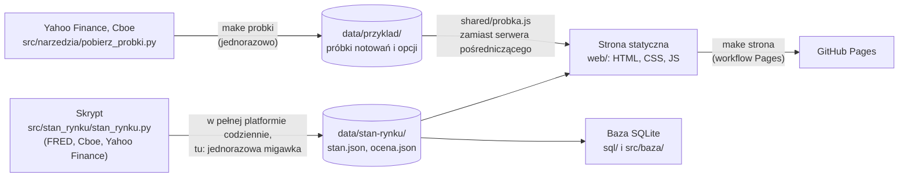

# Przewodnik po repozytorium

> **Wersja poglądowa.** To statyczna, poglądowa część projektu, przeznaczona dla rekrutera, a nie pełnoprawna platforma.
> Pełna platforma jest prywatna: pobiera dane na żywo, ma bramkę logowania i zapisuje ustawienia użytkownika
> w repozytorium. Poniżej opisano to, co jest w tym repozytorium, oraz to, czego tu celowo nie ma.

Sekcje są zwinięte: kliknij nazwę katalogu, żeby zobaczyć opis. Kolejność odpowiada temu, jak dane płyną przez
projekt: skrypt liczy dane, strona je pokazuje, testy pilnują, żeby jedno zgadzało się z drugim.

<b>Co jest w tej wersji, a czego nie ma</b>

| Jest | Czego nie ma (jest tylko w pełnej, prywatnej platformie) |
|---|---|
| karta „Stan rynku": sygnał rynku, 54 wskaźniki, nastroje, historia i tabela skuteczności | pozostałe karty: Social (wiadomości, sezon wyników, sektory), ETF-y sektorowe, News, Youtube, opcje, wykresy, analiza techniczna, Studio i inne |
| karta „Pozycja": generator zakładów z opcji call pod pozycję w ETF, wskaźniki rynku opcji, propozycje, wykres wypłaty | prawdziwe pozycje i historia zakładów zapisywana w repozytorium (tu profile są fikcyjne) |
| karta „VaR": ryzyko strat trzema metodami, liczone dla każdego dnia historii, z wykresem | pobieranie notowań i opcji na żywo przez serwery pośredniczące (Cloudflare Workers) i bramka logowania |
| próbki notowań (Yahoo Finance) i łańcuchów opcji (Cboe) z jednego dnia dla Pozycji i VaR (`data/przyklad/`) | codzienne odświeżanie tych danych |
| karta „Biblioteka": notatki o narzędziach użytych w kodzie | |
| skrypt, który liczy wskaźniki i sygnał (`src/stan_rynku/stan_rynku.py`) | codzienne potoki danych (GitHub Actions) i zaplanowane zadania Claude |
| warstwa SQL (schemat, widoki, testy) | osobiste ustawienia, pozycje i zapisywanie ich ze strony do repozytorium |
| testy, CI, budowa statycznej strony i jej publikacja na GitHub Pages | treści osób trzecich (transkrypcje, artykuły) i nagrania |

Dane Stanu rynku w `data/` to **jednorazowa migawka z sesji 10.11.2026**, a Pozycja i VaR liczą na **próbce z 11.11.2026**:
nic się tu nie odświeża.

<b>Jak to działa w całości</b>

Rachunek „Stanu rynku" robi Python, a przeglądarka tylko czyta gotowy plik z danymi, dlatego ta karta działa bez serwera.
Karty „Pozycja" i „VaR" liczą w przeglądarce (rachunek wartości oczekiwanej, progi i VaR są w JavaScripcie). W pełnej
platformie pytają o notowania i łańcuch opcji własny serwer pośredniczący, a tu `web/shared/probka.js` odpowiada na te same
zapytania zapisanymi próbkami.

<code>src/</code>: kod Pythona

| Plik | Do czego służy |
|---|---|
| `src/stan_rynku/stan_rynku.py` | karta „Stan rynku" w jednym pliku: pobieranie danych, wskaźniki, sygnał, tabela skuteczności oraz HTML i JS strony (generuje `web/stan-rynku/`) |
| `src/pozycja/pozycja.py` | karta „Pozycja" w jednym pliku: rachunek progów, generator zakładów, wartość oczekiwana (EV), wskaźniki rynku opcji, ocena propozycji oraz HTML i JS strony (generuje `web/pozycja/`) |
| `src/var/var.py` | karta „VaR": rachunek VaR (Value at Risk) w Pythonie, używany też przez wskaźniki Stanu rynku, oraz HTML i JS strony (generuje `web/VaR/`) |
| `src/baza/baza.py` | warstwa SQL: buduje bazę SQLite z plików w `data/`, archiwizuje dzienną historię sygnału |
| `src/biblioteka/biblioteka.py` | generator karty „Biblioteka" z plików `.md` w `docs/biblioteka/` |
| `src/narzedzia/mapa_kodu.py` | buduje mapę „numerek bloku → fragment kodu" (zakładka „Kod" w dymku przy numerku) |
| `src/narzedzia/serwer.py` | lokalny podgląd strony (`make serve`) |
| `src/narzedzia/zbuduj_strone.py` | składa katalog `_site/` do publikacji na GitHub Pages (`make strona`) |
| `src/narzedzia/pobierz_probki.py` | pobiera próbki notowań (Yahoo Finance) i łańcuchów opcji (Cboe) do `data/przyklad/` (`make probki`) |

Wzorzec jednoplikowy: cała logika karty (Python, fragmenty HTML i kod JS jako stałe tekstowe) mieszka w jednym pliku
`.py`, a funkcja `generuj()` wypisuje z niego `index.html` i `app.js`. Tych dwóch plików nigdy nie edytuje się ręcznie.

<code>web/</code>: strona

| Ścieżka | Opis |
|---|---|
| `web/index.html` | strona startowa wersji poglądowej (pisana ręcznie) z zastrzeżeniem, czym ta wersja jest |
| `web/404.html` | strona błędu dla GitHub Pages |
| `web/stan-rynku/`, `web/pozycja/`, `web/VaR/`, `web/biblioteka/` | karty (pliki generowane z `src/`) |
| `web/shared/` | wspólne moduły: nawigacja i pasek „Wersja poglądowa" (`sidebar.js`), numerki bloków i dymek z kodem (`oznaczenia.js`), przestrzeń robocza z zakładkami (`przestrzen.js`), siatka okien (`okna.js`), dymki (`dymki.js`), silnik filtrów i sortowania tabel (`tabela.js`, używany przez kartę VaR), adapter próbek notowań i opcji (`probka.js`), moduł zapisu ustawień (`ustawienia.js`, `projekty.js`; w tej wersji nieaktywny), mapa kodu (`mapa-kodu.json`) |
| `web/shared/vendor/` | cudza biblioteka dołączona do repozytorium: TradingView Lightweight Charts 5.2.1 (wykres karty VaR) z licencją Apache 2.0 i opisem pochodzenia |
| `web/style.css` | jeden arkusz stylów z dwiema paletami (Dzień i Noc), kolory tylko ze zmiennych |

Strona używa wyłącznie ścieżek względnych, więc działa pod dowolnym adresem, także pod podścieżką GitHub Pages.

<code>data/</code>: dane

Słownik każdego pliku jest w [`data/README.md`](../data/README.md). W skrócie: `data/stan-rynku/` (dane karty i ocena dnia),
`data/historia/` (dzienny zapis tego, co karta pokazywała) oraz `data/przyklad/` (przycięte próbki notowań i opcji dla kart
Pozycja i VaR). Pliki są w repozytorium, a nie w bazie, bo w gicie dają czytelną historię zmian.

<code>sql/</code>: model bazy i widoki

[`sql/schema.sql`](../sql/schema.sql) (tabele z kluczami i ograniczeniami), [`sql/widoki.sql`](../sql/widoki.sql) (widoki z
funkcjami okna) i [`sql/README.md`](../sql/README.md) (opis modelu, przykłady wyników, sposób testowania). Baza jest
pochodna: `make db` buduje ją od zera z `data/`, więc nie trafia do repozytorium.

<code>tests/</code>: testy

| Plik | Co sprawdza |
|---|---|
| `tests/test_stan_rynku.py` | rachunki wskaźników na przykładach liczonych ręcznie, walidator oceny dnia |
| `tests/test_var.py` | rachunek VaR (kwantyl rozkładu normalnego, progi kroczące) |
| `tests/test_probki.py` | skrypt próbek (przycinanie łańcucha i notowań na danych zmyślonych) oraz spójność zatwierdzonych próbek ze spisem i z potrzebami kart |
| `tests/js/probka.test.mjs` | adapter `web/shared/probka.js` uruchomiony na prawdziwych próbkach (zakresy, zamknięcie poprzedniej sesji, błędy); uruchamia go `node --test` |
| `tests/test_baza.py` | schemat, ograniczenia, widoki SQL porównane z niezależnym rachunkiem w pandas, archiwizator historii |
| `tests/test_kontrakty_danych.py` | poprawność plików JSON (bez `NaN`), spójność tabel i danych karty |
| `tests/test_regeneracja_kart.py` | generatory dają dokładnie te pliki, które są zatwierdzone w `web/` |
| `tests/test_sciezki.py`, `tests/test_sciezki_potokow.py` | każde odwołanie do pliku wskazuje istniejący plik, stałe ścieżek skryptów są poprawne |
| `tests/test_nawigacja.py` | odnośniki nawigacji i listy kart w modułach wspólnych są zgodne, odwołania są względne |
| `tests/test_zbuduj_strone.py` | do publikowanej strony trafia dokładnie to, co ma trafić |
| `tests/test_wersja_pogladowa.py` | straż publicznego repozytorium: brak kluczy, prywatnych adresów e-mail, nagrań i obcych treści |

Wszystkie uruchamia `make check`, czyli ruff, kontrolę składni JS, pytest i `node --test` (to samo robi CI).

<code>docs/</code>: dokumentacja

| Ścieżka | Opis |
|---|---|
| `docs/PRZEWODNIK.md` | ten plik |
| `docs/biblioteka/` | po jednym pliku `.md` na narzędzie; z nich generator składa kartę „Biblioteka" |
| `docs/stan-rynku/instrukcja-oceny.md` | instrukcja dziennej oceny rynku pisanej przez Claude w pełnej platformie (z walidatorem w kodzie) |
| `docs/obrazy/` | zrzuty ekranu używane w głównym `README.md` (strona startowa, Stan rynku w dwóch motywach, Pozycja, VaR) |

<code>projekty/</code>: zapis procesu pracy

W pełnej platformie każde zadanie ma katalog ze specyfikacją, opisem i dziennikiem wykonania. W tej wersji jest jedno,
`projekty/037-nowa-karta-stan-rynku/`: opis zadania napisany przez autora i specyfikacja karty „Stan rynku" (wskaźniki, progi,
wagi, sprawdzenie na historii od 2000 r. i jawnie nazwane ograniczenia). To dokument z chwili powstania, więc
odwołuje się do katalogów pełnej platformy, których tu nie ma.

<code>.github/workflows/</code> i <code>.claude/</code>

`.github/workflows/ci.yml` uruchamia `make lint` i `make test` (pytest oraz testy JavaScriptu) przy każdym pushu. `.github/workflows/pages.yml` składa
stronę (`make strona`) i publikuje ją na GitHub Pages. `.claude/CLAUDE.md` to instrukcje dla asystenta Claude (Claude Code),
z którym powstawał kod: konwencje, wzorzec jednoplikowy, zasady stylu tekstów.

Pliki w korzeniu

`README.md` (wizytówka), `LICENSE` (MIT, dotyczy kodu), `Makefile` (polecenia: `make help`), `pyproject.toml` (konfiguracja
pytest i ruff), `requirements*.txt` (zależności: skrypty, testy, narzędzie opcjonalne), `.python-version`, `.editorconfig`,
`.gitattributes` (oznacza pliki generowane), `.gitignore`.

