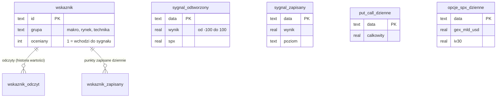

# SQL: model danych i widoki analityczne

Ten katalog opisuje bazę analityczną projektu. Karta „Stan rynku" czyta pliki JSON i pokazuje stan na dziś, ale
historia rośnie z każdym dniem (dzienne statystyki opcji, a od 2026-11-10 także to, co karta pokazywała w danym
dniu). Na pytania o historię, takie jak „co działo się z indeksem po sesjach z danym sygnałem", SQL odpowiada krócej
niż pętle w Pythonie.

## Zasada: pliki są źródłem prawdy, baza jest pochodna

Dane leżą w `data/` jako pliki tekstowe (JSON i CSV), bo w gicie dają czytelne różnice: widać, co dopisał potok
danego dnia. Baza SQLite powstaje z nich od zera i nie trafia do repozytorium (plik binarny powiększałby je przy
każdej zmianie danych). Dzięki temu baza zawsze odpowiada plikom, a jej zniszczenie nic nie kosztuje.

```bash
make db                                                       # buduje data/platforma.sqlite
python src/baza/baza.py zapytanie v_skutecznosc_sygnalu       # wynik widoku w terminalu
python src/baza/baza.py swiezosc                              # czy dane napływają
sqlite3 data/platforma.sqlite                                 # własne zapytania (jeśli masz klienta sqlite3)
```

## Model danych

Są dwa rodzaje tabel. **Wymiary** to słowniki, które rzadko się zmieniają (tu: wskaźniki). **Fakty** to obserwacje
w czasie (wskaźnik put/call w danym dniu, wynik sygnału w danym dniu). Każda tabela faktów ma klucz główny zawierający
datę, więc ten sam dzień nie może wystąpić dwa razy, a ograniczenia `CHECK` pilnują zakresów (np. wynik sygnału od
-100 do 100).



Pełna definicja z komentarzami jest w [`schema.sql`](schema.sql). Stan bazy zbudowanej z danych w tym repozytorium:

| Tabela | Wierszy | Zakres dat |
|---|---|---|
| `wskaznik` | 54 | (słownik wskaźników) |
| `wskaznik_odczyt` | 6932 | historia wartości wskaźników |
| `sygnal_odtworzony` | 752 | 2023-11-10 do 2026-11-10 |
| `sygnal_zapisany` | 1 | 2026-11-10 |
| `wskaznik_zapisany` | 54 | 2026-11-10 |
| `put_call_dzienne` | 1785 | 2019-10-07 do 2026-11-10 |
| `opcje_spx_dzienne` | 8 | 2026-10-30 do 2026-11-10 |

Jak to czytać: najdłuższy jest rząd statystyk put/call od października 2019, a tabele „zapisane" mają na razie jedną
sesję, bo zapis historii ruszył 10 listopada 2026, czyli w dniu tej migawki.

## Dwie historie sygnału: odtworzona i zapisana

Tabela `sygnal_odtworzony` zawiera historię sygnału policzoną **dziś**, według dzisiejszych progów i reguł. Jest
długa (karta liczy ją wstecz), ale zna przyszłość względem dawnych dni: progi dobrano, patrząc na te same dane. To jak
sprawdzian, do którego uczeń znał odpowiedzi. Tabela `sygnal_zapisany` zawiera to, co karta pokazywała w danym dniu,
przy ówczesnych progach. W pełnej platformie jest dopisywana codziennie od 2026-11-10 i tylko ona pozwoli kiedyś
uczciwie ocenić skuteczność sygnału na danych, których nie było przy ustalaniu progów. Dlatego zapis historii nie czeka
na resztę prac: dnia, którego nie zapiszemy, nie da się odtworzyć.

## Widoki: pytania, na które odpowiada baza

Widok to zapisane zapytanie, które wygląda jak tabela (`SELECT * FROM v_skutecznosc_sygnalu`). Zapytania są w
[`widoki.sql`](widoki.sql) i używają funkcji okna (`LEAD`, `MIN() OVER`, `COUNT() OVER`), czyli obliczeń po wierszach
bez zwijania tabeli.

| Widok | Pytanie | Przykład wyniku (dane z 10.11.2026) |
|---|---|---|
| `v_skutecznosc_sygnalu` | Co działo się z indeksem po sesjach z danym poziomem sygnału? | poziom „pozytywny": 556 sesji (73,9%), średni zwrot po 63 sesjach +3,31%, spadek o 10% i więcej po 5,5% sesji |
| `v_swiezosc_danych` | Czy dane napływają? | ostatnia data i liczba wierszy każdej tabeli faktów |

Jak to czytać: widok skuteczności dzieli sesje na pięć poziomów sygnału i dla każdego liczy średni zwrot indeksu po 21 i
63 sesjach, odsetek zwrotów dodatnich, największe obsunięcie w kolejnych 63 sesjach oraz odsetek sesji, po których indeks
spadł o 10% lub więcej. Wynik pokazuje, że sygnał lepiej opisuje ryzyko spadku niż przyszły zwrot, co zgadza się z
opisem w głównym [README](../README.md).

## Jak sprawdzamy, że widoki liczą dobrze

Każdy widok jest w `tests/test_baza.py` porównany z **niezależnym** rachunkiem na tych samych danych. Tabelę
skuteczności liczy na karcie funkcja pandas `skutecznosc`, a widok SQL robi to oknami (`LEAD`, `MIN() OVER`); test
sprawdza, że oba wyniki są takie same. Dwie różne implementacje, które się zgadzają, to mocniejszy dowód niż
sprawdzenie, że zapytanie „coś zwraca".

## Ograniczenia

- Do bazy trafia dzienna historia odtworzona od 2023-11-10 (752 sesje; karta trzyma też dłuższą historię tygodniową,
  której baza jeszcze nie ładuje), więc wyniki widoku `v_skutecznosc_sygnalu` obejmują ostatnie trzy lata i nie muszą
  się zgadzać z tabelą na karcie, która liczy się na pełnej historii od 2000 r. Test porównuje oba rachunki na
  identycznych danych wejściowych.
- Poziomy „silnie pozytywny" i „silnie negatywny" mają w tym oknie po kilka sesji (4 i 3), więc ich średnie są
  statystycznie nieprzekonujące. Widok je pokazuje, ale wniosków nie należy na nich opierać.
